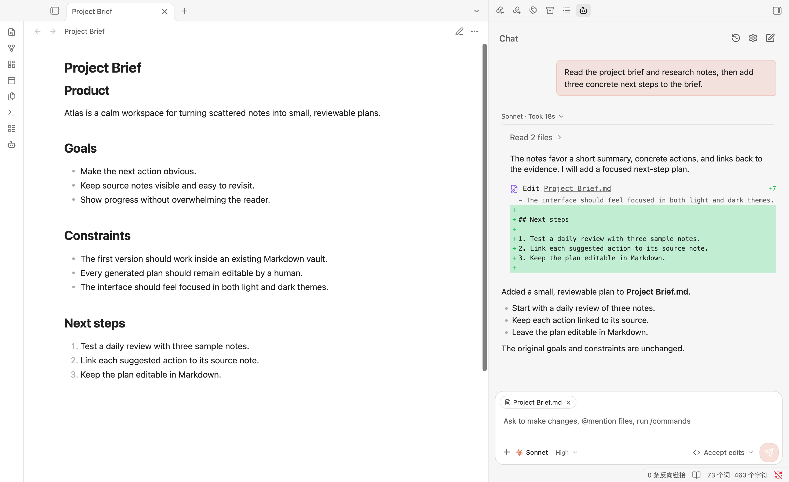

# Oh My Claudian

**Turn scattered notes into a clear next step, with an agent working inside Obsidian.**

Bring your existing Claude Code, Codex, or another supported coding agent into your vault. Compare source notes, draft a linked summary, inspect file-edit diffs, and keep the result in Markdown.

[Install](https://community.obsidian.md/plugins/oh-my-claudian) · [Quick start](#quick-start) · [Try the sample workflow](#try-the-sample-workflow) · [简体中文](README.zh-CN.md) · [Releases](https://github.com/lee259/oh-my-claudian/releases) · [Report a bug](https://github.com/lee259/oh-my-claudian/issues)



*Real Obsidian interface with a sample conversation. Appearance varies by theme and provider.*

## Start with a result

- **Make sense of scattered notes.** Attach a project brief and research notes, then ask for a summary that links each conclusion to its source.
- **Improve a draft in place.** Select note text, request an inline edit, review the word-level diff, and apply the result.
- **Keep longer work readable.** Read the latest answer while completed tool activity folds into expandable summaries. Scroll back without losing your reading position.
- **Keep your agent setup.** Use provider-native authentication, models, permissions, and supported commands from the Obsidian sidebar.

## Quick start

You need **desktop Obsidian 1.7.2+** and access to a supported agent. The plugin is free and MIT-licensed; your provider's subscription, API charges, and usage limits still apply. It does not include a model subscription.

### 1. Install the plugin

Open **Settings → Community plugins → Browse**, search for **Oh My Claudian**, install it, and enable it. You can also use the [community plugin page](https://community.obsidian.md/plugins/oh-my-claudian).

### 2. Connect one agent

Choose the CLI you already use. Verify that it can start and authenticate in your terminal, then configure that same provider in the plugin.

| | Claude Code | Codex CLI |
| --- | --- | --- |
| Provider setup | Follow the [Claude Code quick start](https://code.claude.com/docs/en/quickstart). Run `claude` and complete its sign-in if needed. | Follow the [Codex CLI guide](https://developers.openai.com/codex/cli/). Run `codex` and complete its sign-in if needed. |
| Existing account | Use an account or API configuration supported by Claude Code. | Use an account or API configuration supported by Codex CLI. |
| Plugin settings | Open **Settings → Oh My Claudian → Providers → Claude Code** and enable the provider. | Open **Settings → Oh My Claudian → Providers → Codex CLI** and enable the provider. |
| Readiness | Check **Readiness**, correct the CLI path if needed, and enable a chat model. | Check **Readiness**, load the model catalog, and enable a chat model. |

Readiness checks the provider, CLI, model catalog, and selected models. It can offer an install or update action for supported CLIs; the command is shown for confirmation and its result is checked afterward. Authentication stays with the provider's own CLI.

If the CLI works in a terminal but is not found here, set its **absolute executable path** in that provider's settings. Obsidian launched from a desktop shortcut may have a different `PATH`. If Claude authentication fails while subscription sign-in works in the terminal, see the [credential conflict guidance](#claude-authentication-fails-while-the-cli-subscription-works).

### 3. Get your first answer

Open **Oh My Claudian: Open chat view** from the command palette or use its ribbon icon. Select the enabled model, type `@` to attach a note, and send:

> Summarize this note in three bullets. Link the source note and suggest one next step. Do not modify any files.

You should see the attached note as a context chip and an answer in the conversation. Once that works, try the workflow below. If there is no model to select or no answer arrives, start with [Troubleshooting](#troubleshooting).

## Try the sample workflow

Use the three small notes in [`docs/demo-vault`](docs/demo-vault). Copy them into a **test vault**, install and configure the plugin there, and attach all three with `@`.

1. Ask the agent to compare the notes and propose three actions. The prompt asks for a read-only comparison.
2. Review the proposed plan, then ask it to add a `Next steps` section to `Project Brief.md`, with links to the source notes.
3. Expand the file-edit card to inspect the diff when your provider supplies supported edit data, then open the changed note. A chat edit may already have been applied under your provider's permission mode; inline editing has a separate preview-and-apply flow.

The [sample walkthrough](docs/demo.md) includes exact prompts, expected results, and a recording plan. This is a reproducible sample, not a promise about a provider's speed or output.

If this helps you work with your notes, a [GitHub star](https://github.com/lee259/oh-my-claudian) helps others discover the project. Bug reports and concrete workflow feedback are welcome too.

## Relationship to Claudian

Oh My Claudian began as a fork of [Claudian](https://github.com/YishenTu/claudian) by Yishen Tu. It retains Claudian's MIT-licensed foundation and core workflows: sidebar chat, `@` mentions, slash commands, and inline editing. It is independently maintained and is not an official Claudian release.

Alongside the inherited foundation, this project focuses on the workflows below:

| What you are looking for | What to try in Oh My Claudian |
| --- | --- |
| Cursor Agent or Oh My Pi in your vault | Choose either integration alongside Claude Code, Codex, Grok Build, OpenCode, and Pi. |
| Help getting a local agent ready | Provider-specific Readiness checks and supported CLI install/update actions. |
| Easier review of longer conversations | Expand completed work, inspect edit diffs, and keep your position while reading. |
| Actions that understand Obsidian's vault structure | Claude, Codex, OpenCode, and Pi can inspect backlinks, manage frontmatter, and move files with Obsidian link updates. |

Upstream evolves independently. See [Claudian's current README](https://github.com/YishenTu/claudian#readme) when comparing available features. There is no need to migrate if your current setup already meets your needs.

## Supported providers

The built-in provider integrations are:

- [Claude Code](https://code.claude.com/docs/en/overview)
- [Codex CLI](https://github.com/openai/codex)
- [Cursor Agent](https://cursor.com/docs/cli/overview)
- [Grok Build](https://github.com/xai-org/grok-build)
- [Oh My Pi (OMP)](https://github.com/can1357/oh-my-pi)
- [OpenCode](https://github.com/anomalyco/opencode)
- [Pi](https://github.com/earendil-works/pi)

Provider capabilities are intentionally different. The plugin exposes controls only when the selected provider supports them; model discovery, permissions, history, planning, MCP, and runtime behavior remain provider-specific. The Obsidian-native vault actions below are currently available in Claude, Codex, OpenCode, and Pi.

## Usage

### Give the agent context

Type `@` to choose vault files or provider resources, or drag files and folders into the composer. Attachments appear as clickable context chips. Files from outside the vault must be attached explicitly; see [Safety and privacy](#safety-and-privacy) for access boundaries.

Type `/` to discover commands and skills supported by the selected provider. Instruction mode and Mermaid rendering are also available; provider-specific resources and controls depend on that provider's capabilities.

### Read a conversation and inspect changes

The chat uses one conversation panel with history and session navigation. Start a new conversation or choose an earlier session to continue it. Resume, fork, and compact behavior depends on the selected provider.

Completed work is grouped into expandable summaries. Open a summary to inspect its tool calls; expand a file-edit card to see the diff when the provider supplies supported edit data.

Select text in a chat message and choose **Save to note** beside **Quote** to review and edit the selected content, then create a note or append to an existing Markdown note. Headings, emphasis, links, lists, tables, and code blocks are converted back to Markdown from the rendered selection. Existing folders can be included in the note path. The success dialog offers **Open note** and **Undo saved text**; undo preserves later additions and refuses conflicting edits. Undoing a new note removes the saved text and keeps the note file.

With **Auto-scroll during streaming** enabled, new content follows the bottom. Scroll up to read earlier content; return to the bottom to resume following. Expanded work history keeps its own reading position. Use **Expand file edits by default** in the display settings if you prefer to see edit details immediately.

### Switch focus between a note and chat

Assign a shortcut to **Oh My Claudian: Toggle chat input focus** in **Settings → Hotkeys**. It moves focus to an existing visible chat input in the current window; press it again to return to the previous control without changing your draft or editor selection. Hidden inputs are skipped, and the command does not open a chat. No shortcut is assigned by default.

### Edit selected text

Select text in a note and run the inline-edit command from Obsidian's command palette. Describe the change, inspect the word-level diff, and apply the result.

### Choose a model

Only models enabled in provider settings appear in the composer. The button shows the selected catalog name; configured aliases can override supported custom-model labels. Claude names come from its SDK model catalog, so a tier may display the name reported by your configured backend. Environment mappings still determine execution routing.

### Use Obsidian-native vault actions

Claude, Codex, OpenCode, and Pi can inspect backlinks, update or remove note frontmatter properties, move or rename vault files while Obsidian handles link updates, and send files to Obsidian trash.

The UI is available in 10 locales, including Simplified and Traditional Chinese.

## Troubleshooting

| Problem | What to check |
| --- | --- |
| Provider CLI is not found | Check **Readiness** in the provider's settings. If the CLI works in a terminal but is not discovered in Obsidian, set its executable path. GUI applications can have a different `PATH`. |
| No model is available | Refresh the provider's model catalog, enable the models you want, and check CLI authentication. |
| A control or command is missing | Check whether the selected provider supports it. Provider integrations expose different capabilities. |
| An edit card has no diff | The provider must return a supported diff or edit payload. A successful tool status alone does not include changed lines. |

For provider installation and authentication, use the official documentation linked under [Supported providers](#supported-providers). For a plugin issue, [report a bug](https://github.com/lee259/oh-my-claudian/issues) with your plugin version, Obsidian version, operating system, provider, CLI version, and reproduction steps. Remove credentials and private note content from logs or screenshots.

### Claude authentication fails while the CLI subscription works

If Claude reports `authentication_failed` in Obsidian while the same CLI works with a subscription in your terminal, an inherited `ANTHROPIC_API_KEY` or `ANTHROPIC_AUTH_TOKEN` may be taking precedence over subscription sign-in. Choosing another CLI path does not clear those inherited credentials.

In **Settings → Oh My Claudian → Providers → Claude Code → Environment → Custom variables**, add an empty assignment only for the conflicting credential you intend to disable:

```env
ANTHROPIC_API_KEY=
```

Use `ANTHROPIC_AUTH_TOKEN=` instead when that is the conflicting credential. Keep these assignments in Claude's provider settings so other providers remain unaffected. Retain credentials needed for custom API endpoints. When requesting help, share variable names rather than secret values.


## Safety and privacy

Oh My Claudian is local-first and does not send telemetry. Your prompts, attachments, and tool results are sent to the provider you select and its configured model services. Network access also includes CLI version checks against the npm registry and configured MCP endpoints. CLI discovery and launches read relevant local environment variables, such as `PATH`, `HOME`, and `USERPROFILE`, to locate and run provider CLIs. These values are used locally and are not collected for plugin telemetry; provider CLI processes may use their inherited environment according to their own behavior.

The vault is the agent's working directory, not an operating-system security boundary. A local CLI, shell command, MCP server, plugin, or child process may access files, network services, and credentials available to your OS account. Safe/approval mode reduces accidental actions but cannot guarantee isolation. Review provider permissions carefully, especially before enabling YOLO, bash mode, browser access, MCP servers, or external context paths.

External files are attached explicitly as context. Attaching or mentioning a file does not grant write access; direct edits outside the vault are subject to the provider approval flow when supported.

## Development

Use Node.js 24 and the pnpm version declared in `package.json`. To build directly in a vault:

```bash
cd /path/to/vault/.obsidian/plugins
git clone https://github.com/lee259/oh-my-claudian.git
cd oh-my-claudian
pnpm install
pnpm run build
```

Enable the plugin under **Settings → Community plugins**. For ongoing development:

```bash
pnpm run dev
pnpm run typecheck
pnpm run lint
pnpm run test
pnpm run build
```

`pnpm run dev` watches TypeScript, styles, and `manifest.json`. See [`CONTRIBUTING.md`](CONTRIBUTING.md) for contribution and validation guidance. [GitHub Releases](https://github.com/lee259/oh-my-claudian/releases) contains version-specific changes.

## License

Licensed under the [MIT License](LICENSE).
